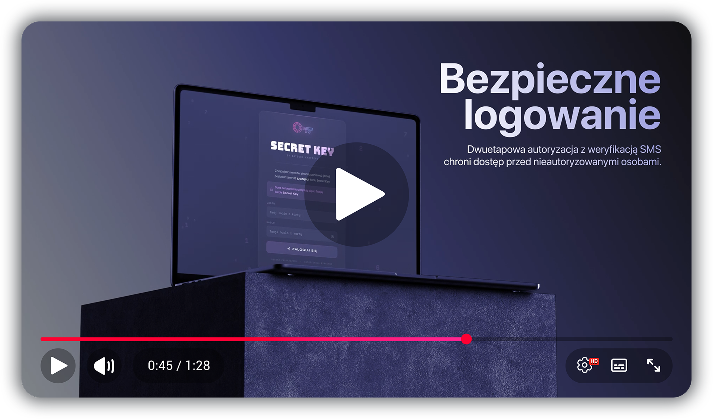

<div align="center">


</div>

---

<p align="center">
  <a href="../../README.md">🇵🇱 Polski</a> •
  <a href="README_EN.md">🇬🇧 English</a> •
  <a href="README_ES.md">🇪🇸 Español</a> •
  <kbd>🇩🇪 Deutsch</kbd> •
  <a href="README_PT_BR.md">🇧🇷 Português (Brasil)</a> •
  <a href="README_FR.md">🇫🇷 Français</a> •
  <a href="README_ZH.md">🇨🇳 简体中文</a> •
  <a href="README_AR.md">🇸🇦 العربية</a> •
  <a href="README_HI.md">🇮🇳 हिन्दी</a> •
  <a href="README_JA.md">🇯🇵 日本語</a> •
  <a href="README_RU.md">🇷🇺 Русский</a> •
  <a href="README_UK.md">🇺🇦 Українська</a>
</p>

---

<div align="center">

### Ein kryptografisches Notfallzugriffssystem für Ihre Passwortdatenbank

<br>

[](https://php.net)
[](#stack)
[](#installation)
[](#sicherheit)
[](#shamir-algorithmus)
[](../../LICENSE)

<br>

**Was passiert mit Ihren Konten nach Ihrem Tod?**

Secret Key teilt das Master-Passwort Ihrer Passwortdatenbank kryptografisch unter vertrauenswürdigen Personen auf.  
Niemand kennt es allein — nur gemeinsam, zu einem vereinbarten Zeitpunkt, können sie es rekonstruieren.

<br>


<br>

[**→ Demo ansehen**](https://app.secretkey.website) &nbsp;·&nbsp; [**Projektwebsite**](https://secretkey.website) &nbsp;·&nbsp; [**Dokumentation**](https://secretkey.website/docs)

</div>

---

## Inhaltsverzeichnis

- 01 · 🔑 [Idee](#idee)
- 02 · ⚙️ [So funktioniert es](#so-funktioniert-es)
- 03 · 🎬 [Systemübersicht](#systemübersicht)
- 04 · 💳 [Secret Key-Karte](#secret-key-karte)
- 05 · 🔐 [Shamir-Algorithmus](#shamir-algorithmus)
- 06 · 🏗️ [Systemarchitektur](#systemarchitektur)
- 07 · 🛡️ [Sicherheit](#sicherheit)
- 08 · 🚀 [Installation](#installation)
- 09 · 📁 [Dateistruktur](#dateistruktur)
- 10 · ❓ [FAQ](#faq)

---

## Idee

Jeder von uns hat Dutzende Passwörter — für E-Mail, die Foto-Cloud, 2FA-Codes, Kryptowährungen. **Was passiert damit nach unserem Tod?** Banken und Erbschaft haben ihren eigenen Rechtsweg, aber E-Mail, Cloud oder Krypto auf einem eigenen Schlüssel bleiben oft für immer verschlossen.

Secret Key speichert und entschlüsselt selbst nichts: Es teilt das Master-Passwort Ihrer Passwortdatenbank (z. B. KeePass, Bitwarden) unter vertrauenswürdigen Personen auf. Die Datenbankdatei liegt auf Ihrem eigenen Server, und Ihre Angehörigen können sie erst nach Erreichen des Quorums, SMS-Bestätigung und 48-Stunden-Sperre herunterladen. Was in der Datenbank steht, entscheiden Sie. Secret Key ist kein Rechtsinstrument und ersetzt weder Testament noch Nachlassverfahren; es ergänzt sie dort, wo das Recht nicht hilft.

Secret Key löst dieses Problem, indem es einen sicheren Notfallplan mit zwei Garantien schafft:

| &nbsp; | Problem | Lösung |
|---|---|---|
| 🔐 | Unbefugter Zugriff **zu Lebzeiten** des Besitzers | Jeder Zugriffsversuch erfordert ein Passwort + einen SMS-Code |
| 💀 | Angehörige ohne Zugriff auf Ihre Passwortdatenbank **nach dem Tod** | Beauftragte Personen rekonstruieren das Master-Passwort mit dem Shamir-Algorithmus und laden die Datenbankdatei herunter |

Das System ist **vollständig selbst gehostet** — Daten verlassen niemals Ihren Server. Keine zentrale Datenbank, keine Cloud, keine externen Abhängigkeiten außer dem SMS-Versand.

<a name="stack"></a>

```
Backend       PHP 8+, flache Dateien (JSON + PHP-Konfig), kein SQL
Autorisierung bcrypt cost=10, 2FA per SMS über die SMSPlanet-API
Kryptografie  Shamir Secret Sharing (secrets.js)
Frontend      Reines HTML + JS, keine externen Abhängigkeiten (offline)
```

---

## So funktioniert es

In einer Krisensituation führen die beauftragten Personen vier Schritte aus:

```
┌──────────────────────────────────────────────────────────────────────┐
│                                                                      │
│  01  VERSAMMELN      Min. 3 von 5 beauftragten Personen               │
│      ─────────       Jede besitzt eine Karte mit einem Schlüsselteil │
│                                                                      │
│  02  ANMELDEN        Anmeldedaten von der Secret-Key-Karte            │
│      ──────────      + ein SMS-Code an die hinterlegte Rufnummer     │
│                                                                      │
│  03  ANTEILE         Jede Person gibt ihren Anteil ein oder           │
│      ─────────       scannt den QR-Code von der Karte                │
│                                                                      │
│  04  ZUGRIFF         Passwort wird lokal im Browser rekonstruiert —   │
│      ────────        mit SECRET_HASH auf dem eigenen Server geprüft   │
│                                                                      │
└──────────────────────────────────────────────────────────────────────┘
```

**Ohne das der Karte zugeordnete Telefon ist eine Anmeldung unmöglich**, selbst mit Kenntnis der Kartendaten.  
**Ohne die erforderliche Anzahl an Anteilen ist die Rekonstruktion des Passworts mathematisch unmöglich**, selbst mit Zugriff auf den Server.

---

## Systemübersicht

<p align="center">
  <a href="https://www.youtube.com/watch?v=omx7mpQD5-M" target="_blank">
    
  </a>
</p>

> [!TIP]
> 🔊 Das Video ist in mehreren Sprachen verfügbar — klicken Sie im YouTube-Player auf ⚙️ → **Untertitel/Audio (Audiospur)**, um die Synchronisationssprache zu wählen oder Untertitel zu aktivieren.

---

## Secret Key-Karte

Jede beauftragte Person erhält einen personalisierten Träger mit vier Elementen:

| Element | Beschreibung |
|---|---|
| 🔑 **Login und Passwort** | Eindeutige Zugangsdaten — jede Person hat ein eigenes Konto mit hinterlegter Rufnummer |
| 🔢 **Shamir-Anteil** | Ein Schlüsselfragment im Hex-Format — eines von fünf, nutzlos ohne die übrigen |
| ⊞ **QR-Code** | Derselbe Anteil als QR-Code codiert — das Scannen vermeidet Fehler beim manuellen Abtippen |
| 🌐 **Systemadresse** | Die URL Ihrer eigenen Secret-Key-Instanz — führt direkt zum Anmeldebereich |

**Das Format des Trägers ist frei wählbar** — ein ausgedrucktes Blatt, ein PDF, eine Plastikkarte. Wichtig ist, dass er die vier oben genannten Elemente enthält.

---

## Shamir-Algorithmus

Secret Key verwendet die Bibliothek [`secrets.js`](https://github.com/grempe/secrets.js) (Fork von [amper5and/secrets.js](https://github.com/amper5and/secrets.js), gebündelt über [iancoleman.io/shamir](https://iancoleman.io/shamir/)), um das Geheimnis aufzuteilen und zu rekonstruieren.

> [!NOTE]
> Die verwendete Bibliothek ist **identisch mit der von [iancoleman.io/shamir](https://iancoleman.io/shamir/) verwendeten** — das Anteilsformat ist vollständig kompatibel, was eine unabhängige Überprüfung außerhalb des Systems ermöglicht.

### Aufteilung und Rekonstruktion des Geheimnisses

```
Master-Passwort: "MyKeePassPassword2024!"
         │
         ▼  Aufteilung in 5 Anteile (Schwellenwert: 3)
         │
    ┌────┴──────────────────────────────────┐
    │                                       │
    │  S1: 801a3f9c2e4b7d1...  →  Person A  │  Jeder Anteil
    │  S2: 802c8f1a5e9b3d7...  →  Person B  │  ist ohne die
    │  S3: 803e2a7f4c1b9d5...  →  Person C  │  übrigen
    │  S4: 804b6d3e8f2a1c9...  →  Person D  │  nutzlos
    │  S5: 805d9f7b2e4c3a1...  →  Person E  │
    │                                       │
    └────┬──────────────────────────────────┘
         │
         ▼  Rekonstruktion — beliebige 3 von 5 genügen
         │
    S1 + S2 + S3  →  "MyKeePassPassword2024!"  ✓
    S2 + S4 + S5  →  "MyKeePassPassword2024!"  ✓
    S1            →  keine Information über das Geheimnis  ✗
```

### Kryptografische Eigenschaften

Das Geheimnis wird als konstanter Term eines Polynoms über dem Körper GF(2⁸) codiert. Jeder Anteil ist ein Punkt auf diesem Polynom — bei Kenntnis der erforderlichen Anzahl an Punkten kann es durch Lagrange-Interpolation eindeutig rekonstruiert werden:

```
f(x) = a₀ + a₁x + a₂x² + ... + aₖ₋₁xᵏ⁻¹  (mod p)
```

> [!IMPORTANT]
> Der Besitz von **weniger als der erforderlichen** Anzahl an Anteilen liefert **keinerlei** Information über das Geheimnis (information-theoretic security). Das zusätzliche 1024-Bit-Padding verhindert Angriffe auf kleine Geheimnisse.

### Implementierungsparameter

| Parameter | Wert |
|---|---|
| Bibliothek | secrets.js (grempe-Fork, via iancoleman.io/shamir) |
| Anteilsformat | `8` + 2-Hex-x-Koordinate + Daten |
| minPad | 1024 Bit |
| Kodierung | UTF-8 (str2hex) |
| Rekonstruktion | JavaScript (Browser); das Passwort wird nicht gespeichert — mit `SECRET_HASH` auf dem Server per HTTPS geprüft |

### Wahl der Aufteilungsparameter

| Gesamtzahl der Anteile | Erforderliches Minimum | Szenario |
|---|---|---|
| 3 | 2 | Kleine Familie |
| 5 | 3 | Standard *(empfohlen)* |
| 7 | 4 | Größere Familie / Unternehmen |

---

## Systemarchitektur

Der Benutzer durchläuft nacheinander mehrere Verifizierungsebenen, bevor er Zugriff auf geschützte Ressourcen erhält:

```
Benutzer     →  gibt Login + Passwort ein
                         │
PHP-System   →  überprüft das Passwort (bcrypt), prüft Rate Limiting und CSRF
                         │
SMS / 2FA    →  sendet einen Einmalcode an die hinterlegte Rufnummer
                         │
Benutzer     →  gibt den SMS-Code ein
                         │
PHP-System   →  überprüft den Code, erstellt eine Sitzung, merkt sich optional das Gerät
                         │
Browser      →  nimmt die Shamir-Anteile entgegen, rekonstruiert das Geheimnis lokal in JS
```

### Systemebenen

**Autorisierungsebene** (`/app/`)
- `login.php` — das Anmeldeformular
- `auth.php` — Sitzungslogik, bcrypt, 2FA, Brute-Force-Schutz, CSRF, sowie die Hilfsfunktionen `t()` (UI-Texte), `md_lite()` (Markdown-Lite), `empty_state_box()`
- `verify.php` — Überprüfung des SMS-Codes
- `resend.php` — erneuter SMS-Versand
- `logout.php` — Abmeldung

**Zugriffsebene** (`/decrypt/`)
- `index.php` — das Entschlüsselungspanel mit Shamir-Rekonstruktion in JS; überprüft das Ergebnis mit zwei unabhängigen Methoden (mathematische Konsistenz über Anteil-Teilmengen + Textformat-Analyse), statt sich nur auf das Ausbleiben einer Ausnahme zu verlassen
- `download.php` — geschützte Dateidownloads (erfordert eine Sitzung, eine aus der Konfiguration erstellte Whitelist, serverseitige Protokollierung) + harte, vom Panel unabhängige Timelock-Validierung
- `log.php` — Ereignisprotokollierung
- `devtools-log.php` — Protokollierung von DevTools-Inspektionsversuchen (mit IP-basiertem Rate Limiting)
- `timelock.php` — Timelock-Logik nach Vertrauenspersonen-Absprache (siehe [Sicherheit](#sicherheit))
- `arm-timelock.php` — aktiviert die 48h-Sperre nach bestätigter Passwort-Rekonstruktion, versendet die Alarm-E-Mail
- `panic.php` — verarbeitet den einmaligen "Panic Button"-Link aus der E-Mail
- `tl-status.php` — Live-Abfrage des Sperrzustands (kein Neuladen des Panels nötig)

**Datenebene** (`/private/` — außerhalb von `public_html`)
- `secret-key.php` — eine einzige Konfigurationsdatei: Personen (`$people`), herunterladbare Dateien (`$downloads`), Anleitung (`$instructions`), E-Mail-Benachrichtigung (`$email_notify`), SMS-Domain
- `lang.php` — Oberflächentexte (eine einzige Sprache, kein Umschalter — siehe [Installation](#installation))
- `rate-limit.php` — dauerhaftes Rate Limiting (Zähler unabhängig von der Sitzung)
- `rate_limits.json` — Anmeldeversuch-Zähler pro IP/Konto *(wird automatisch erstellt)*
- `trusted_devices.json` — Tokens für vertrauenswürdige Geräte *(wird automatisch erstellt)*
- `timelock.json` — Zustand der 48h-Sperre nach Vertrauenspersonen-Absprache *(wird automatisch erstellt, siehe [Sicherheit](#sicherheit))*
- `secret-key.log` — Ereignisprotokolle
- `moja-baza-hasel.kdbx` *(und weitere herunterladbare Dateien)* — werden ausschließlich über `download.php` ausgeliefert, nie direkt über HTTP

> [!WARNING]
> Alle sensiblen Konfigurationsdateien werden **außerhalb des öffentlichen Verzeichnisses** des Servers gespeichert — eine fehlerhafte Webserver-Konfiguration birgt kein Risiko, sie offenzulegen.

---

## Sicherheit

Das System kombiniert **neun unabhängige Schutzebenen** — die Kompromittierung einer Ebene gewährt keinen Zugriff auf das System.

| Ebene | Mechanismus | Details |
|---|---|---|
| 🔒 **Passwörter** | bcrypt | cost=10, Format `$2y$`, timing-attack-resistente Überprüfung |
| 🛡️ **CSRF** | 64-Hex-Token | Kryptografisch generiert, überprüft bei jedem zustandsändernden Endpunkt (Anmeldung, 2FA-Verifizierung, erneuter SMS-Versand, Abmeldung, Ereignisprotokoll) |
| 🚫 **Brute-Force** | Rate Limiting | 3 Versuche/IP + 3 Versuche/Konto in einem 15-Minuten-Fenster; 3 falsche SMS-Codes/Stunde. Dauerhafte serverseitige Zähler (eine Datei, unabhängig von der Sitzung/den Cookies des Clients) |
| 📱 **2FA per SMS** | 6-stelliger Code | Kryptografisch generiert, 10 Minuten gültig, 60 Sekunden Abkühlzeit zwischen den Versendungen |
| 💻 **Vertrauenswürdige Geräte** | SHA-256, HttpOnly | Secure + SameSite=Strict, Datei außerhalb von `public_html`, TTL 7 Tage |
| ⏱️ **Sitzung** | Auto-Logout | Sitzungscookie mit expliziten HttpOnly- + Secure- + SameSite=Strict-Flags; 30-Minuten-Timeout, Erneuerung der Sitzungs-ID nach jeder Verifizierung |
| 🖥️ **Oberflächenschutz** | DevTools-Erkennung | Erkennt Entwicklertools, entfernt das DOM physisch, protokolliert den Vorfall mit IP, REF# und Dauer |
| 📥 **Geschützte Downloads** | `download.php` + Whitelist | Herunterladbare Dateien liegen außerhalb von `public_html`; eine aktive Sitzung ist erforderlich, keine direkte URL, immer serverseitig protokolliert |

> [!TIP]
| 🚨 **Schutz vor Vertrauenspersonen-Absprachen** | 48h-Timelock + Panic Button + serverseitige Verifizierung | Die erste erfolgreiche Passwort-Rekonstruktion (optional serverseitig über `SECRET_HASH` verifiziert) blockiert Datei-Downloads für 48h und sendet eine Alarm-E-Mail mit einem einmaligen Link, um den Zugriff sofort und dauerhaft zu blockieren — siehe unten |

> **Schutz vor Absprachen der Vertrauenspersonen zu Lebzeiten.** Der Shamir-Algorithmus erlaubt es den benannten Vertrauenspersonen mathematisch, das Master-Passwort selbst zu rekonstruieren, wenn sie sich dazu absprechen — das ist eine unvermeidliche Eigenschaft jedes Schwellenwert-Secret-Sharing-Verfahrens, nicht nur dieses. Das System reagiert darauf auf drei Ebenen: (1) im Browser wird die **Konsistenz** der kombinierten Anteile geprüft (mathematische Konsistenz über Anteil-Teilmengen + Analyse des Ergebnisformats) — das filtert Tippfehler und zufälliges Rauschen heraus, bestätigt aber für sich genommen **nicht**, dass das kombinierte Geheimnis das echte Passwort ist (eine angemeldete Person könnte vollständig konsistente, aber frei erfundene Anteile mit einem völlig anderen „Passwort" einfügen); (2) wenn du das optionale, aber dringend empfohlene `SECRET_HASH` in der Konfiguration setzt (ein Bcrypt-Hash des echten Passworts, automatisch vom Dashboard berechnet), **verifiziert** der Server das kombinierte Geheimnis tatsächlich über `password_verify()`, bevor irgendetwas scharf geschaltet wird; (3) erst nach dieser Verifizierung **blockiert es Datei-Downloads für 48 Stunden** und sendet dir eine E-Mail mit einem einmaligen "Panic Button"-Link — ein Klick trennt den Zugriff dauerhaft, bevor irgendjemand etwas herunterladen kann. Die bloße Kenntnis des Passworts ist ohne die physische Datenbankdatei wertlos. Für maximalen Schutz wird zusätzlich empfohlen, einen Hardware-Schlüssel (z. B. YubiKey/FIDO2) als zweiten Faktor für die Passwortdatenbank selbst zu verwenden.

---

## Installation

### Voraussetzungen

- PHP 8.0+
- Ein Webserver (Apache / Nginx)
- Ein Konto bei [SMSPlanet](https://smsplanet.pl) (zum Versenden von 2FA-Codes)
- Zugriff auf ein Verzeichnis außerhalb von `public_html`

---

### Schritt 1 — Konfiguration (offline)

Öffnen Sie `dashboard.html` lokal in Ihrem Browser. Es enthält drei Registerkarten:

**Konfiguration** — generiert die Datei `secret-key.php`:
1. Das SMSPlanet-API-Token, den SMS-Absendernamen und die Domain für das automatische Ausfüllen des Codes (Android/iOS) — nur die Domain, ohne `@` und ohne `https://`
2. Den Schwellenwert (K) der erforderlichen Codes im Wiederherstellungs-Panel — muss mit dem im Tab Verschlüsselung festgelegten Schwellenwert übereinstimmen — sowie optional, aber empfohlen: das echte Master-Passwort (dasselbe wie im Tab Verschlüsselung), aus dem das Dashboard automatisch einen Hash für die serverseitige Verifizierung berechnet (siehe [Schutz vor Vertrauenspersonen-Absprachen](#sicherheit))
3. Für jede beauftragte Person: Login, Passwort, Vorname, Nachname, Telefonnummer und ob sie in der Inhaberliste im Panel sichtbar sein soll
4. Herunterladbare Dateien (Passwortdatenbank, 2FA-Datenbank, Programm-Installer) — Schlüssel, Button-Beschriftung, Dateiname
5. Die Anleitungsschritte für das Panel (Formatierung: `**fett**` / `*kursiv*`)
6. Optional: eine E-Mail-Benachrichtigung bei jeder Anmeldung (Empfängeradresse, Absender, Link zum Panel)
7. Klicken Sie auf „Konfiguration generieren" und laden Sie die generierte Datei `secret-key.php` herunter

**Verschlüsselung** — teilt das Master-Passwort in Shamir-Anteile auf:
1. Geben Sie das Master-Passwort zur Passwortdatenbank ein
2. Legen Sie die Gesamtzahl der Anteile und das erforderliche Minimum fest
3. Klicken Sie auf „Anteile generieren"
4. Laden Sie die Datei `secret-key-shares.txt` herunter

**Kartengenerator** — erstellt personalisierte Secret-Key-Karten, druckfertig (ISO-ID-1-Format, 85,6×54mm):
1. Globale Einstellungen: die Instanz-URL und der vollständige Name des Inhabers
2. Aufteilungsparameter (Gesamtzahl der Anteile und erforderliches Minimum) — konsistent mit den Registerkarten Konfiguration und Verschlüsselung
3. Eine bearbeitbare Nachricht auf der Rückseite der Karte, mit Platzhaltern zum automatischen Einfügen der Anteilsanzahl, des Schwellenwerts und der Instanz-URL
4. Für jede Person: Login, Passwort und Shamir-Anteil (hex) — Daten aus den beiden vorherigen Registerkarten
5. Optional: 2mm Beschnitt und Schnittlinien für den Druck in einer Druckerei
6. Klicken Sie auf „Karten generieren" — Vorschau von Vorder- und Rückseite jeder Karte, bereit zum Herunterladen als PDF

> [!WARNING]
> Wenn Sie die serverseitige Prüfung nicht nutzen, entfernen Sie die gesamte Zeile `define('SECRET_HASH', …)` aus der Konfiguration. In v3.1.0 führte ein leerer Wert (`define('SECRET_HASH', '');`) dazu, dass das Panel jedes Passwort ablehnte, auch das richtige. Ab v3.1.1 wird ein leerer Wert wie eine nicht gesetzte Konstante behandelt, die Konfiguration ist ohne die Zeile aber sauberer. Der Dashboard-Generator lässt sie weg, wenn das Feld „Echtes Master-Passwort“ leer ist.

> [!TIP]
> Alle drei Werkzeuge arbeiten **vollständig offline** — es verlassen keine Daten den Browser. Das Konfigurationsformular generiert `secret-key.php` bei jedem Durchlauf von Grund auf neu — es lädt oder bearbeitet keine bestehende Datei.

---

### Schritt 2 — Hochladen auf den Server

```bash
/home/user/
├── public_html/
│   ├── app/           ← Inhalt des Ordners /app/
│   └── decrypt/       ← Inhalt des Ordners /decrypt/
└── private/           ← AUSSERHALB von public_html
    ├── secret-key.php  ← die generierte Konfigurationsdatei
    ├── lang.php        ← Oberflächentexte (eine Sprache, siehe Schritt 1)
    ├── rate-limit.php  ← eine Systemdatei aus dem Repository (Rate Limiting)
    └── moja-baza-hasel.kdbx  ← Ihre Dateien (ausgeliefert über download.php)
```

> [!WARNING]
> `lang.php` muss **zusammen mit** `secret-key.php` auf den Server hochgeladen werden. `auth.php` lädt sie über `require_once` — eine fehlende Datei bringt das gesamte System zum Absturz (ein fataler Fehler auf jeder Seite), nicht nur die Übersetzungen.

---

### Schritt 3 — Pfad zur Konfiguration

In der Datei `auth.php` (Ordner `app/`) kommt der Pfad zum Ordner `/private/` an **7 Stellen** vor. Passen Sie alle an, nicht nur das erste `require_once`:

```php
// app/auth.php
require_once __DIR__ . '/../../../private/secret-key.php';
require_once __DIR__ . '/../../../private/rate-limit.php';
require_once __DIR__ . '/../../../private/lang.php';

define('LOG_FILE',    __DIR__ . '/../../../private/secret-key.log');
define('PRIVATE_DIR', __DIR__ . '/../../../private');

// ×2 (rememberDevice() + trusted-device check)
$file = __DIR__ . '/../../../private/trusted_devices.json';
```

Standardmäßig steht an jeder dieser Stellen das Fragment `/../../../private`. Der Pfad wird ab dem Ordner gezählt, in dem `auth.php` liegt; passen Sie ihn also an Ihre Verzeichnisstruktur an. Beispiel: `auth.php` liegt in `/public_html/ihre-domain/` und `/private/` neben `/public_html/`; dann ändern Sie `/../../../private` an allen sieben Stellen in `/../../private` (im Editor „Alle ersetzen“ verwenden).

---

### Schritt 4 — Domain im SMS-Inhalt (WebOTP)

Der Inhalt des versendeten SMS-Codes endet mit der Zeile `@domain #code` — dies ist das von der [WebOTP-API](https://developer.mozilla.org/en-US/docs/Web/API/WebOTP_API) geforderte Format, dank dem der Browser auf dem Telefon das Codefeld selbstständig ausfüllt, ohne manuelles Abtippen aus der SMS.

Sie legen die Domain in **Schritt 1** fest, im Dashboard-Formular (Feld „Domain für SMS-Autofill") — Sie geben nur die Domain ein, ohne `@` und ohne `https://` (das Dashboard fügt das `@` automatisch hinzu). Sie gelangt in die Konfiguration als:

```php
define('SMS_AUTOFILL_DOMAIN', '@ihre-domain.de');
```

> [!WARNING]
> Die Domain muss **exakt** mit der übereinstimmen, unter der Sie das System hosten — andernfalls ignoriert WebOTP die SMS und das Autofill funktioniert nicht. Der Code kommt trotzdem an und funktioniert bei manueller Eingabe, nur ohne diesen Komfort.

---

### Schritt 5 — Verteilung der Karten

Bereiten Sie für jede beauftragte Person einen Träger vor mit:
- Login und Passwort (aus der Registerkarte Konfiguration)
- einem Shamir-Anteil (aus der Datei `secret-key-shares.txt`)
- optional: einem QR-Code mit demselben Anteil
- der Adresse Ihrer Systeminstanz

---

## Dateistruktur

```
secret-key/
│
├── 📁 app/                        # Öffentlich — Anmeldesystem
│   ├── 📁 decrypt/                # Geschützt — Benutzerpanel
│   │   ├── .htaccess
│   │   ├── arm-timelock.php
│   │   ├── card-secret-key.webp
│   │   ├── devtools-log.php
│   │   ├── download.php
│   │   ├── favicon.ico
│   │   ├── index.php
│   │   ├── key.svg
│   │   ├── log.php
│   │   ├── panic.php
│   │   ├── timelock.php
│   │   └── tl-status.php
│   ├── .htaccess
│   ├── auth.php
│   ├── favicon.ico
│   ├── key.svg
│   ├── login.php
│   ├── logout.php
│   ├── resend.php
│   └── verify.php
│
├── 📁 dashboard/                  # Konfigurationswerkzeuge (offline)
│   ├── card-back.js
│   ├── card-front.js
│   ├── dashboard.html
│   ├── favicon.ico
│   ├── generate-card.html
│   ├── generate-hash.html
│   └── generate-shamir.html
│
├── 📁 img/                        # Grafikressourcen
│
└── 📁 private/                    # Außerhalb von public_html — Konfigurationsdateien
    ├── .htaccess
    ├── demo-baza-hasel.txt         # Beispiel für eine herunterladbare Datei (durch eigene ersetzen)
    ├── lang.php                    # Oberflächentexte (eine Sprache)
    ├── rate-limit.php
    └── secret-key.php
```

---

## FAQ

<details>
<summary><strong>Was passiert, wenn ich meine Secret-Key-Karte verliere?</strong></summary>

Die Karte allein ist nutzlos ohne Zugriff auf das dem Konto zugeordnete Telefon — die Anmeldung erfordert eine SMS-Verifizierung. Das Risiko ist begrenzt, dennoch sollte der Besitzer informiert werden und erwägen, eine neue Konfiguration mit einem neuen Satz von Anteilen zu generieren.

</details>

<details>
<summary><strong>Kann ich das Passwort mit nur einer Karte allein auslesen?</strong></summary>

Nein. Das ist mathematisch unmöglich. Ein einzelner Anteil offenbart keinerlei Information über das Geheimnis — dies ist eine Eigenschaft des Algorithmus namens information-theoretic security. Erst das Sammeln der erforderlichen Anzahl an Anteilen ermöglicht die Rekonstruktion des Master-Passworts.

</details>

<details>
<summary><strong>Was, wenn eine der beauftragten Personen stirbt oder nicht verfügbar ist?</strong></summary>

Das System ist mit Redundanz konzipiert — es genügt, die minimal erforderliche Anzahl an Anteilen zu sammeln (z. B. 3 von 5). Die Nichtverfügbarkeit einer oder zweier Personen blockiert das Notfallverfahren nicht, solange sich die übrigen versammeln können.

</details>

<details>
<summary><strong>Erreicht das Passwort während der Entschlüsselung den Server?</strong></summary>

Die Rekonstruktion erfolgt im Browser. Wenn Sie `SECRET_HASH` in der Konfiguration setzen (empfohlen), wird das Passwort danach per HTTPS an Ihren eigenen Server gesendet, nur damit `password_verify()` es mit `SECRET_HASH` vergleichen kann. Der Server speichert oder protokolliert es nicht. Ohne `SECRET_HASH` verlässt das Passwort den Browser nie.

</details>

<details>
<summary><strong>Was passiert, wenn sich die Vertrauenspersonen absprechen und zu meinen Lebzeiten ohne mein Wissen das Passwort wiederherstellen?</strong></summary>

Das Passwort allein reicht ihnen nicht. Die Datenbankdateien liegen außerhalb des öffentlichen Verzeichnisses des Servers, und der Zugriff darauf wird von `download.php` kontrolliert. In dem Moment, in dem das Passwort im Panel zum ersten Mal erfolgreich rekonstruiert wird — optional, aber dringend empfohlen, auch serverseitig über `SECRET_HASH` verifiziert, damit die bloße Konsistenz der kombinierten Anteile (ohne Kenntnis des echten Passworts) nicht ausreicht, um die Sperre zu erzwingen — blockiert das System automatisch die Datei-Downloads für 48 Stunden und sendet dir eine Alarm-E-Mail mit einem einmaligen „Panic Button"-Link — ein Klick trennt den Zugriff dauerhaft, sodass du in Ruhe das Master-Passwort ändern kannst. Wenn du die Passwortdatenbank zusätzlich mit einem Hardware-Schlüssel (z. B. YubiKey) schützt, reicht die bloße Kenntnis des Passworts auch nach der Freigabe der Dateien nicht aus, um sie zu öffnen.

</details>

<details>
<summary><strong>Kann ich das System mit einem anderen Passwort-Manager als KeePassXC verwenden?</strong></summary>

Ja. Secret Key speichert und rekonstruiert **jedes beliebige Master-Passwort** — unabhängig vom verwendeten Manager. Kompatibel mit jedem Programm, das ein Master-Passwort unterstützt: KeePassXC, Bitwarden, 1Password und anderen.

</details>

<details>
<summary><strong>Wie wähle ich den Schwellenwert — wie viele Anteile sind erforderlich?</strong></summary>

Je höher der Schwellenwert, desto größer die Sicherheit — aber auch desto schwieriger die Versammlung in einer Krisensituation. Der empfohlene Kompromiss für den Standardgebrauch ist **3 von 5** — er toleriert die Nichtverfügbarkeit zweier Personen bei gleichzeitig gutem Schutzniveau.

</details>

<details>
<summary><strong>Wie lange sind die Anmeldedaten einer Karte gültig?</strong></summary>

Unbegrenzt — solange der Besitzer keine neue Konfiguration generiert und die Datei `secret-key.php` auf dem Server ersetzt. Nach diesem Vorgang funktionieren die alten Karten nicht mehr, und es müssen neue an alle beauftragten Personen verteilt werden.

</details>

<details>
<summary><strong>Ersetzt Secret Key ein Testament oder das Nachlassverfahren?</strong></summary>

Nein. Secret Key ist kein Rechtsinstrument. Geld auf einem Bankkonto erhält die Familie auf dem förmlichen Erbweg; Secret Key ergänzt diesen dort, wo das Recht nicht hilft: Zugriff auf E-Mail, Foto-Cloud, 2FA-Codes oder Kryptowährungen auf einem eigenen Schlüssel. Das ist keine Rechtsberatung, und die Bedingungen mancher Dienste können die Weitergabe von Passwörtern einschränken.

</details>

<details>
<summary><strong>Sieht meine Familie meine gesamte private Korrespondenz?</strong></summary>

Secret Key entschlüsselt nichts und hat keinen Zugriff auf Ihre E-Mails oder Messenger. Es teilt nur das Master-Passwort Ihrer Passwortdatenbank (z. B. KeePass, Bitwarden); die Datenbankdatei bleibt auf Ihrem Server. Nach Erreichen des Quorums, SMS-Bestätigung und 48-Stunden-Sperre laden Ihre Angehörigen diese Datei herunter, und was darin ist, bestimmen Sie. Sie können eine separate Notfalldatenbank nur mit den Konten für die Familie vorbereiten.

</details>

<details>
<summary><strong>Ist das nicht zu kompliziert? Reicht nicht ein verschlüsselter USB-Stick mit einem Zettel?</strong></summary>

Für viele reicht ein USB-Stick mit Zettel und ist einfacher. Secret Key ist für alle, die nicht alles an einem Ort bei einer Person halten wollen: Das Passwort wird unter mehreren Vertrauenspersonen aufgeteilt, und der Zugriff ist durch SMS und eine 48-Stunden-Sperre geschützt, die Sie abbrechen können. Die Einrichtung ist technisch (eigener Server; Offline-Dashboard und Dokumentation vereinfachen sie), Ihre Angehörigen erhalten nur Karten und eine Anleitung.

</details>

---

<div align="center">

Wenn dir dieses Projekt geholfen hat, hinterlasse einen ⭐ — das hilft anderen, die es vielleicht brauchen, es zu finden.

</div>

---

<div align="center">

Copyright © 2026 · [karpierz.me](https://karpierz.me)

</div>
